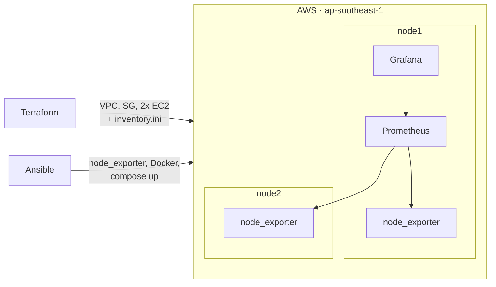

# DevOps Bootcamp 2026 — Hands-on Cloud & Infrastructure Portfolio

Hands-on DevOps work from a 2026 bootcamp, going from IAM basics to a **fully automated AWS monitoring stack** built with Terraform, Ansible, Docker and Prometheus/Grafana. Every folder is one session, and each one builds on the last.


---

## ⭐ Highlights

### 1. Automated monitoring stack: [`grafana/`](grafana)
Terraform provisions a VPC and two EC2 nodes and **generates the Ansible inventory**. Ansible installs `node_exporter`, installs Docker, and deploys **Prometheus + Grafana with Docker Compose**. Dashboards and metrics are only reachable from the operator's IP.



### 2. Private servers with zero inbound ports: [`terraform3/`](terraform3)
Terraform Registry modules (VPC, EC2, SG) with a NAT gateway. The private instance is published through a **Cloudflare Tunnel**, and its token is pulled from **SSM Parameter Store** at deploy time, not stored in Git.

### 3. Configuration management that's safe to re-run: [`ansible2/`](ansible2)
Jinja2 templates fed by `ansible_facts`, handlers that restart nginx only when its config changes, and an **online disk-resize playbook** (`growpart` + `resize2fs`) with explicit `changed_when` / `failed_when`.

### 4. CI/CD with GitHub Actions: [`cicd4/`](cicd4)
Test-gated pipelines, branch protection, secrets vs. variables, building to **GHCR**, and auto-deploy through a **self-hosted runner**.

---

## 🗺️ Learning Path

| # | Session | What I built | Key skills |
|---|---|---|---|
| 1 | [AWS 1](aws1) | IAM user + AWS CLI | IAM, least privilege, CLI profiles |
| 2 | [AWS 2](aws2) | EC2 with IAM role, accessed through SSM | EC2, instance profiles, Session Manager, S3 |
| 3 | [AWS 3](aws3) | Custom VPC networking | VPC, CIDR, subnets, route tables |
| 4 | [AWS 4](aws4) | Container registry + private egress | ECR, NAT gateway, Elastic IP, cost cleanup |
| 5 | [Cloudflare 1](cloudflare1) | Custom-domain static site | DNS delegation, Cloudflare Pages |
| 6 | [Cloudflare 2](cloudflare2) | EC2 behind Cloudflare | Proxied DNS, SSL modes, Cloudflare Tunnel |
| 7 | [Docker 1](docker1) | Container basics | Images, containers, lifecycle |
| 8 | [Docker 2](docker2) | Custom images | Dockerfile, layers, build & tag |
| 9 | [Docker 3](docker3) | Image registry & persistence | ECR push, volumes, networks |
| 10 | [Docker 4](docker4) | Multi-container app | Docker Compose |
| 11 | [CI/CD](cicd4) | GitHub Actions pipelines | Workflows, test gates, secrets, GHCR, runners |
| 12 | [Terraform 1](terraform1) | VPC as code | IaC workflow, providers, resources |
| 13 | [Terraform 2](terraform2) | Public + private EC2 | Variables, outputs, S3 remote state with locking |
| 14 | [Terraform 3](terraform3) | Module-based infra + tunnel | Registry modules, NAT, `user_data`, SSM params |
| 15 | [Terraform 4](terraform4) | AI-assisted IaC | Terraform MCP server, AI agent tooling |
| 16 | [Ansible 1](ansible1) | Terraform → Ansible pipeline | Generated inventory, playbooks |
| 17 | [Ansible 2](ansible2) | Templated web servers | Jinja2, handlers, disk resize |
| 18 | [Prometheus](prometheus) | Metrics collection | node_exporter, Prometheus Ansible collection |
| 19 | [Grafana](grafana) | Full observability stack | Prometheus + Grafana with Docker Compose |

---

## 🔐 Security Practices

- **No long-lived secrets in Git.** Tunnel tokens come from AWS SSM Parameter Store; `*.tfstate`, `*.tfvars`, keys and generated inventories are git-ignored.
- **SSM Session Manager instead of SSH** for the Terraform 2–3 servers, so port 22 stays closed.
- **Least-privilege security groups.** SSH, Prometheus and Grafana are open only to the operator's current IP (`/32`, looked up at plan time), and node_exporter only inside the VPC.
- **Private subnets + NAT / Cloudflare Tunnel** for servers that shouldn't be directly reachable.
- **Remote state** in S3 with lockfile-based state locking.
- **Cost hygiene.** Billable resources (NAT gateways, EC2) are destroyed after each session.

---

## 🚀 Running a Project

Prerequisites: AWS CLI (configured), Terraform ≥ 1.15, Ansible, and an EC2 key pair for the Ansible sessions.

```bash
cd grafana                               # or any terraform*/ansible*/prometheus folder
terraform init
terraform apply                          # provisions infra + writes inventory.ini
ansible-galaxy install -r requirements.yml
ansible-playbook playbook-exporter.yaml
ansible-playbook playbook-stack.yaml
terraform destroy                        # clean up when done
```

> The Terraform projects use an S3 backend (`bucket = "devops-fikri"`). To run them in your own account, change the bucket in `providers.tf` or remove the `backend` block to use local state.

---

## 🧰 Tech Stack

| Area | Tools |
|---|---|
| Cloud | AWS (IAM, EC2, VPC, S3, ECR, SSM, NAT, EIP) |
| Infrastructure as Code | Terraform (AWS provider v6, Registry modules, S3 backend) |
| Configuration management | Ansible (playbooks, Jinja2, handlers, Galaxy roles/collections) |
| Containers | Docker, Docker Compose, ECR, GHCR |
| CI/CD | GitHub Actions, self-hosted runners, branch protection |
| Observability | Prometheus, node_exporter, Grafana |
| Networking / Edge | Cloudflare DNS, Pages, Proxy, Tunnel |
| Workflow | Git, feature branches, pull requests (see [CONTRIBUTING](CONTRIBUTING.md)) |

---

<sub>Built by <a href="https://github.com/devops-fikri">@devops-fikri</a> · DevOps Bootcamp 2026</sub>
