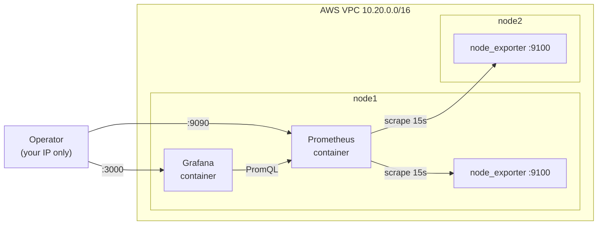

# Grafana — Full Monitoring Stack (Terraform + Ansible + Docker Compose)

End-to-end observability stack on AWS, provisioned and configured fully as code.



**How it's built**

1. **Terraform** creates the VPC, a security group and 2 × `t3.small` Ubuntu nodes (16 GB disk), then writes the Ansible inventory.
2. **Ansible** grows the disks, installs `node_exporter` on both nodes, installs Docker on node1 (`geerlingguy.docker`), copies the configs and runs `docker compose up -d`.
3. **Docker Compose** runs Prometheus (config bind-mounted from the repo) and Grafana (data in a named volume).

**Security:** Grafana, Prometheus and SSH are only reachable from the operator's IP (`/32`). node_exporter is only reachable inside the VPC.

| File | Purpose |
|---|---|
| [`compose.yaml`](compose.yaml) | Prometheus + Grafana services |
| [`prometheus.yaml`](prometheus.yaml) | Scrape config (15 s interval) |
| [`playbook-stack.yaml`](playbook-stack.yaml) | Docker install + deploy stack to node1 |
| [`playbook-exporter.yaml`](playbook-exporter.yaml) | node_exporter on all nodes |
| [`playbook-disk.yaml`](playbook-disk.yaml) | Online disk resize |
| [`security.tf`](security.tf) | Least-privilege ingress rules |
| [`requirements.yml`](requirements.yml) | Ansible roles and collections used |

```bash
terraform init && terraform apply
ansible-galaxy install -r requirements.yml
ansible-playbook playbook-disk.yaml
ansible-playbook playbook-exporter.yaml
ansible-playbook playbook-stack.yaml
# Grafana: http://<node1_ip>:3000  → add data source http://prometheus:9090
```
