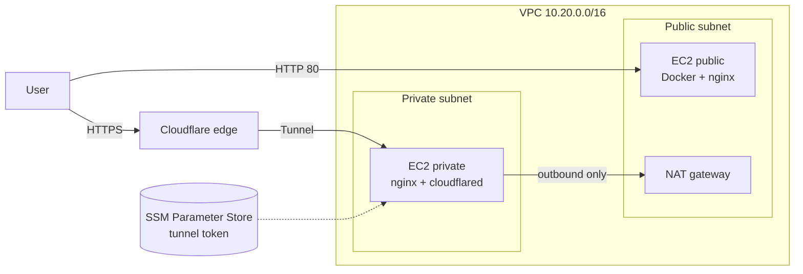

# Terraform 3 — Modules, NAT Gateway, user_data & Cloudflare Tunnel

Refactored the raw resources into **community modules** from the Terraform Registry and automated server setup.

- `terraform-aws-modules/vpc`, `ec2-instance` and `security-group` modules.
- Single **NAT gateway** so the private instance can pull images.
- **`user_data`** installs Docker and starts nginx on boot (`templatefile()`).
- The private instance runs **`cloudflared`**, so it's reachable from the internet through a Cloudflare Tunnel with **zero inbound ports**.
- The tunnel token is read from **SSM Parameter Store**, never committed to Git.

| File | Purpose |
|---|---|
| [`network.tf`](network.tf) | VPC module with public/private subnets and NAT |
| [`security.tf`](security.tf) | Security group module |
| [`ec2.tf`](ec2.tf) | Two EC2 module instances + SSM parameter lookup |
| [`userdata.sh`](userdata.sh) / [`userdata-tunnel.sh`](userdata-tunnel.sh) | Boot scripts |
| [`outputs.tf`](outputs.tf) | Public IP + SSM connect commands |
